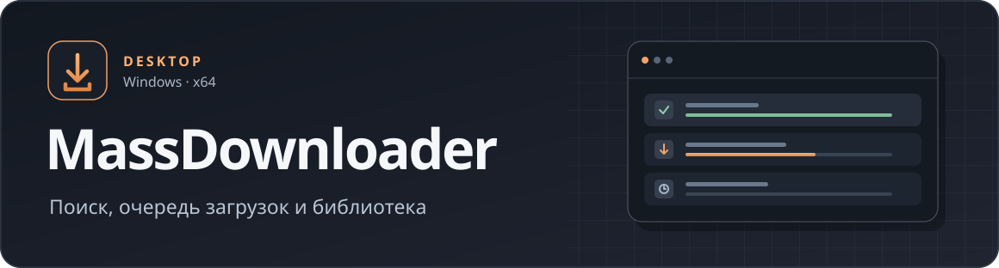

<p align="center">
  
</p>

<p align="center">
  Загрузчик изображений, видео и вложений для Windows с предпросмотром, очередью и локальной библиотекой.
</p>

<p align="center">
  <a href="https://github.com/WortexDaniel/MassDownloader-Desktop/releases/latest/download/MassDownloader.exe"><strong>Скачать для Windows x64</strong></a>
  · <a href="https://github.com/WortexDaniel/MassDownloader-Desktop/releases">Все релизы</a>
  · <a href="https://github.com/WortexDaniel/MassDownloader-Desktop/issues">Сообщить об ошибке</a>
</p>

## Быстрый старт

1. Скачайте `MassDownloader.exe` со страницы [Releases](https://github.com/WortexDaniel/MassDownloader-Desktop/releases/latest).
2. Поместите файл в папку, куда Windows разрешает запись, и запустите его. Приложение портативное и запускается напрямую.
3. Выберите сайт, введите запрос или задайте фильтры. Если источнику нужен аккаунт, заполните форму «Авторизация сайта» в верхней панели.
4. Откройте пост или выделите карточки и нажмите «Скачать выбранные». Статус файлов появится во вкладке «Загрузки». Папку сохранения можно выбрать в интерфейсе.

Для запуска нужны **Windows 10 или 11 x64** и **Microsoft Edge WebView2 Runtime**. Если среды WebView2 нет, установите её с сайта Microsoft. [Скачать WebView2 Runtime](https://developer.microsoft.com/microsoft-edge/webview2/#download)

## Возможности

| Раздел | Что можно сделать |
| --- | --- |
| Поиск и просмотр | Искать по тегам и авторам, применять фильтры сайта, просматривать изображения, видео и страницы альбомов. Карточки показывают статус загрузки. |
| Очередь загрузок | Скачивать посты, отдельные вложения и работы автора, раскладывать файлы по папкам авторов, повторять ошибки и открывать расположение сохранённых файлов. |
| Избранное и лента | Сохранять посты и авторов. В отдельном окне ленты можно объединять источники, фильтровать по авторам и выражениям тегов. |
| Обратный поиск | Проверять, встречается ли выбранное изображение в доступных поисковых сервисах. |
| Библиотека изображений | Индексировать локальные папки, искать дубли по имени, байтам, пикселям или визуальному сходству и сравнивать кандидатов. |
| Работа с файлами | Выбирать, какие копии сохранить, объединять папки авторов и конвертировать статические изображения в JPEG, PNG и WebP. |
| Сеть и кэш | Настраивать прокси, лимиты запросов и объём кэша миниатюр и видео. |

### Библиотека и дубли

Откройте «Библиотека изображений», добавьте папки и запустите сканирование. Во вкладке «Дубли» выберите группы и откройте «Предпросмотр удаления». План показывает сохраняемый экземпляр и изменения по каждой группе, включая переносы связей в истории загрузок.

Удаляемые файлы попадают в карантин внутри папки библиотеки. «Операции» позволяет восстановить их, пока файлы и связи не изменены последующими действиями. Конвертация по умолчанию создаёт копии. Визуальное сходство помогает подобрать кандидатов для сравнения.

## Источники

| Группа | Адаптеры в приложении |
| --- | --- |
| Имиджборды | e621, e6ai, Danbooru, AIBooru, Konachan, Gelbooru, Rule34, Xbooru, TBIB, Sankaku Channel, Idol Complex |
| Архивы публикаций | Kemono, Coomer, Pawchive, OnlyHaven |
| Портфолио и соцсети | Pixiv, DeviantArt, FurAffinity, X, Misskey.io |

Поиск, фильтры и способы входа различаются по источникам. Например, Rule34 требует `api_key` и `user_id`. Для ряда других сайтов форма авторизации подсказывает, какие cookies нужны. Доступность зависит от сайта, его ограничений и учётной записи.

## Где хранятся данные

| Путь рядом с EXE | Содержимое |
| --- | --- |
| `data/app.db` | Настройки, данные для входа, избранные посты и авторы |
| `data/history.db` | История загрузок, индекс библиотеки и журнал файловых операций |
| `data/thumbs/`, `data/logs/`, `data/webview*/` | Миниатюры, журналы и профили WebView2 |
| `data/video_tmp/` | Кэш видео, если он включён |
| `downloads/` | Папка загрузок по умолчанию |

Для обновления закройте приложение и замените EXE в той же папке. Для переноса на другой компьютер перенесите также `data/` и папку с загрузками. Если изменился абсолютный путь к файлам, выберите новую папку загрузок в настройках.

## Сборка из исходников

Потребуются Windows x64, [Go 1.26](https://go.dev/dl/), Node.js с npm и Wails CLI v2. Для запуска собранного приложения также нужен WebView2.

```powershell
git clone https://github.com/WortexDaniel/MassDownloader-Desktop.git
Set-Location MassDownloader-Desktop

go install github.com/wailsapp/wails/v2/cmd/wails@v2.15.0
Copy-Item assets\icon.png build\appicon.png
Copy-Item assets\icon.ico build\windows\icon.ico
wails build -platform windows/amd64 -m -nosyncgomod -trimpath
```

Команда `go install` кладёт Wails в каталог Go для программ, обычно `%USERPROFILE%\go\bin`. Добавьте этот каталог в `PATH`, чтобы команда `wails` была доступна. Сборка установит зависимости интерфейса через `npm ci`. Готовый файл появится в `build/bin/MassDownloader.exe`.

| Путь | Назначение |
| --- | --- |
| `main.go` и файлы Go в корне | Запуск Wails, взаимодействие интерфейса с Go, окна ленты и библиотеки |
| `internal/sites/` | Адаптеры источников |
| `internal/downloader/`, `internal/library/` | Очередь скачивания и операции с локальными изображениями |
| `frontend/src/` | Интерфейс на JavaScript и CSS |
| `assets/`, `build/windows/` | Иконки, манифест Windows и версия приложения |

## Ошибки и предложения

Укажите версию MassDownloader, версию Windows, источник и шаги для воспроизведения. При необходимости приложите фрагмент `data/logs/app.log`, предварительно удалив из него ключи, cookies и личные данные. [Создать задачу на GitHub](https://github.com/WortexDaniel/MassDownloader-Desktop/issues/new)

Лицензии сторонних компонентов приведены в [THIRD_PARTY_NOTICES.txt](THIRD_PARTY_NOTICES.txt).
